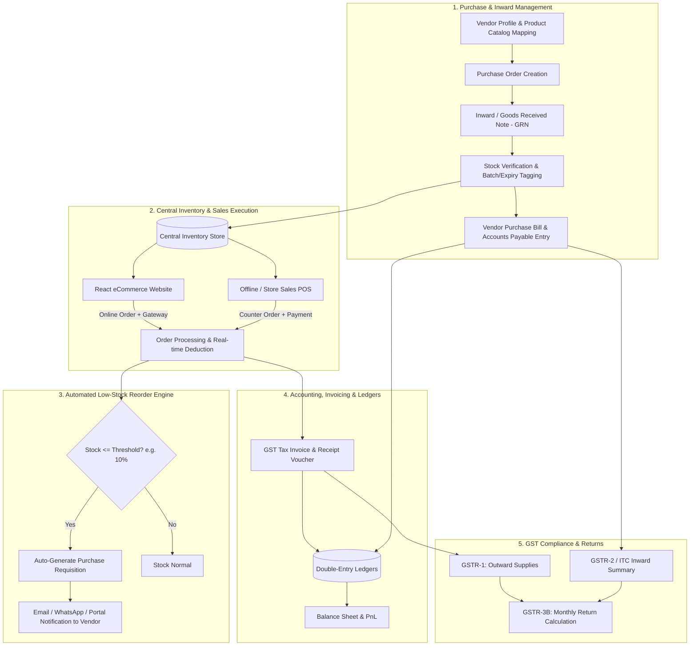

# Prakruti ERP Blueprint: Purchase, Inward Stock, Vendor Management, Full Accounting & GST Compliance

## 1. Executive Overview

This document outlines the end-to-end architecture and system flow for extending the **Prakruti** platform from an eCommerce store into an integrated **Retail ERP & Supply Chain Management System**.

The system establishes an automated loop:
1. **Purchase & Vendor Management:** Onboard vendors, map products with costings, issue Purchase Orders (PO), and process Goods Received Notes (GRN / Inward).
2. **Unified Omnichannel Inventory:** Inward stock flows directly into available stock for Online (React frontend) and Offline (POS / Walk-in) channels.
3. **Automated Reordering (Trigger Threshold):** Real-time stock drops below reorder thresholds (e.g. 10% or minimum buffer levels) trigger automated Purchase Requisitions / Requests directly to designated vendors.
4. **Sales, Invoicing & Receipts:** Payment gateway webhooks and offline sales record transactions, adjust real-time inventory, and automatically generate GST Tax Invoices and credit/debit notes.
5. **Full Double-Entry Accounting:** Automated ledger postings for Purchases (Accounts Payable), Sales (Accounts Receivable), Inventory Valuation, Cash/Bank, and Input/Output Tax ledgers.
6. **Statutory GST Reporting:** Auto-compilation of **GSTR-1** (Outward supplies), **GSTR-2 / 2B reconciliation** (Inward / ITC), and **GSTR-3B** (Summary return).

---

## 2. End-to-End System Workflow



---

## 3. Module Breakdown & Architecture

### Module 1: Vendor & Product-Wise Procurement
* **Vendor Master:**
  * Legal name, Trade name, GSTIN, PAN, MSME status, contact details, payment terms (Net 15, Net 30, COD), bank details.
  * Vendor State Code & Place of Supply (determines CGST+SGST vs. IGST on inward purchases).
* **Vendor-Product Matrix:**
  * Multiple vendors per product/variation with:
    * Vendor SKU / Item Code
    * Unit Purchase Rate & Applicable Tax Slab (0%, 5%, 12%, 18%)
    * Minimum Order Quantity (MOQ)
    * Lead time (days)
    * Primary vendor designation flag

### Module 2: Inward Stock Flow (PO -> GRN -> Stock)
1. **Purchase Order (PO):**
   * Drafted manually or triggered by automated reorder system.
   * Tracks status: `Draft`, `Sent`, `Partially Received`, `Completed`, `Cancelled`.
2. **Goods Receipt Note (GRN / Inward):**
   * Warehouse staff verifies received physical items against the PO.
   * Handles short-supply, damaged goods, or excess quantities.
   * Optional Batch Number, Manufacturing Date, and Expiry Date tracking (essential for Ayurvedic & wellness products).
3. **Inventory Reflection:**
   * On GRN approval, inventory increments automatically across all channels.
   * Product becomes immediately available on the React store if previously `out-of-stock`.

### Module 3: Inventory Deductions & Low-Stock Auto-Reorder
* **Real-time Deductions:**
  * **Online Orders:** Stock reserved at checkout, deducted permanently upon successful payment gateway webhook (Razorpay/Cashfree/Stripe).
  * **Offline/POS Orders:** Instant deduction upon invoice finalization at counter.
* **Auto-Reorder Engine:**
  * Configurable reorder rule per product/variant:
    * **Percentage Based:** e.g., Current Stock $\le$ 10% of Maximum Capacity.
    * **Quantity Threshold:** e.g., Current Stock $\le$ Safety Buffer (e.g. 15 units).
  * Scheduled cron job (or post-sale event listener) evaluates stock levels.
  * **Action Triggered:**
    * Automatically generates a **Purchase Requisition (PR)** or draft **Purchase Order (PO)** to the primary vendor.
    * Dispatches automated dispatch email / WhatsApp notification / vendor portal alert.
    * Sends notification to Store Admin Dashboard for approval/dispatch.

### Module 4: Sales, Invoicing & GST-Inclusive Pricing Architecture

* **GST-Inclusive Product Pricing (Storefront Display):**
  * All retail prices shown across the React storefront, catalog, and cart are **strictly MRP / Inclusive of GST**.
  * No surprise tax added on checkout: if a product is ₹500, the customer pays ₹500 (plus flat shipping if applicable).

* **Backward / Reverse GST Extraction Formula:**
  * For any product priced inclusive of tax at rate $R\%$ (e.g. 5%, 12%, 18%):
    $$\text{Taxable Value} = \frac{\text{Inclusive Price}}{1 + \left(\frac{R}{100}\right)} = \frac{\text{Inclusive Price} \times 100}{100 + R}$$
    $$\text{Total GST Amount} = \text{Inclusive Price} - \text{Taxable Value}$$
  * *Tax Splitting Logic:*
    * **Intra-State (Customer State == Business State e.g. Gujarat):**
      * $\text{CGST} = \frac{\text{Total GST}}{2}$
      * $\text{SGST} = \frac{\text{Total GST}}{2}$
    * **Inter-State (Customer State != Business State):**
      * $\text{IGST} = \text{Total GST}$
  * *Example (Product at ₹1,180 inclusive of 18% GST):*
    * Taxable Value = $\frac{1180 \times 100}{118} = ₹1,000$
    * Total GST = ₹180
    * If Intra-State: CGST (9%) = ₹90, SGST (9%) = ₹90. Total paid by buyer remains ₹1,180.

* **B2B Customer GSTIN Claim (Checkout & Account):**
  * **Frontend Checkout Option:** Checkbox *"Are you purchasing for a registered business? Add GSTIN for Input Tax Credit"*.
  * **Fields:** Business/Company Name + 15-character GSTIN.
  * **Validation:** Real-time regex validation (`^[0-9]{2}[A-Z]{5}[0-9]{4}[A-Z]{1}[1-9A-Z]{1}Z[0-9A-Z]{1}$`) + state-code cross-check against delivery state.
  * **Tax Invoice Generation:**
    * If GSTIN is provided: Generated as a formal **B2B Tax Invoice** with buyer's GSTIN, Trade Name, Place of Supply, and HSN-wise table so they can legally claim Input Tax Credit (ITC). Automatically routes to **GSTR-1 Table 4A (B2B)**.
    * If no GSTIN: Generated as **B2C Retail Invoice / Bill of Supply**, routed to **GSTR-1 Table 7 (B2C Others)**.

* **PDF GST Tax Invoice Delivery & Downloads:**
  * **Automated PDF Generation:** Built using Laravel PDF engine (e.g. `barryvdh/laravel-dompdf` or Browsershot) with clean branding, GSTIN, HSN table, reverse tax breakup, QR code, and signature block.
  * **Customer Email Attachment:** Immediately upon successful order payment, a transactional email is queued and dispatched to the customer containing:
    * Order summary & payment gateway receipt details.
    * Official GST Tax Invoice attached as a PDF (`Invoice_PRAK_26-27_0001.pdf`).
  * **Customer Account Download:** Customer can log in on the React website (`#account` / My Orders) and click **"Download Tax Invoice (PDF)"** anytime.
  * **Backend Admin Download & Printing:** Store admins can view, download, or bulk-print GST invoices directly from the Laravel Admin Order details screen.

* **Payment Gateway Reconciliation & Notes:**
  * Payment gateway reference ID, transaction status, settled amount, gateway fees, and GST on gateway charges logged for reconciliation.
  * Support for credit notes / debit notes on return orders with tax adjustments.


### Module 5: Tri-Partite Synchronization Engine (Purchase ⟷ Sales ⟷ Accounting)

The ERP is designed with a **Perpetual Inventory & Automated Double-Entry Core**. Purchase, Sales, and Accounting do not operate as isolated silos; they are strictly **synchronized in real time** through transactional event listeners:

```
[ Purchase Inward (GRN) ]  ───► Updates Stock (+Qty) ───► Auto-Posts Purchase Journal & AP
            │                                                      │
            ▼                                                      ▼
[ Omnichannel Sales ]      ───► Updates Stock (-Qty) ───► Auto-Posts Sales Journal, Tax & COGS
            │                                                      │
            ▼                                                      ▼
[ Reorder / Return Engine] ───► Debit Notes / Auto-PO ──► Reverses ITC & Adjusts Payables
```

* **1. Synchronized Purchase ⟷ Accounting (On Inward Approval):**
  * Approving a GRN / Purchase Bill simultaneously:
    1. Increases physical & available inventory by batch.
    2. Updates the weighted average / landed cost of the SKU.
    3. Triggers immediate financial entries in the General Ledger:
       * **Debit:** `Inventory Asset` (at Landed Cost)
       * **Debit:** `Input Tax Credit - CGST / SGST / IGST`
       * **Debit:** `Inward Freight / Cartage Expense` (if billed separately)
       * **Credit:** `Vendor Accounts Payable` (exact liability recognized)

* **2. Synchronized Sales ⟷ Accounting (On Order Placement / POS Counter):**
  * Confirming an online order (via payment gateway) or counter sale simultaneously:
    1. Deducts live stock via FEFO allocation (locks batch number).
    2. Triggers invoice numbering and dispatches the GST PDF.
    3. Auto-posts the revenue & tax journals:
       * **Debit:** `Bank / Gateway Settlement Clearing Account` (or `Cash` for POS)
       * **Credit:** `Sales Revenue (Taxable Value)`
       * **Credit:** `Output Tax Liability - CGST / SGST / IGST`
    4. Auto-posts the simultaneous **Cost of Goods Sold (COGS)** matching entry:
       * **Debit:** `Cost of Goods Sold (COGS Expense)` (at batch landed cost)
       * **Credit:** `Inventory Asset`
    * *Integrity Benefit:* Real-time gross margin and balance sheet valuation are always 100% accurate without manual month-end adjustments.

* **3. Synchronized Purchase Returns ⟷ Accounting (On RTV / Debit Note):**
  * When goods are returned to vendor:
    1. Physical inventory drops immediately.
    2. Reverses the purchase value and tax credit:
       * **Debit:** `Vendor Accounts Payable`
       * **Credit:** `Inventory Asset`
       * **Credit:** `Input Tax Credit (ITC Reversal)`

* **4. Synchronized Sales Returns ⟷ Accounting (On Refund / Credit Note):**
  * When a customer returns a product:
    1. Generates Credit Note and updates sales register for GSTR-1.
    2. Auto-restores restockable batch to inventory (or flags damaged).
    3. Journal entry:
       * **Debit:** `Sales Returns / Revenue Deduction`
       * **Debit:** `Output Tax Liability (Tax Adjustment)`
       * **Credit:** `Customer Refund Payable / Gateway Refund`
       * *Simultaneous COGS Reversal:* Debit `Inventory Asset`, Credit `COGS Expense`.

* **5. Reconciliation Integrity (Zero-Discrepancy Guarantee):**
  * `Inventory Quantity on Hand × Average Landed Cost` **always equals** `Inventory Asset Ledger Balance`.
  * `Unpaid Vendor Purchase Bills` **always equals** `Accounts Payable Ledger Balance`.
  * `GSTR-1 Tax Summary` **always equals** `Output GST Liability Account`.
  * `GSTR-2 Eligible ITC` **always equals** `Input GST Asset Account`.

### Module 6: GST Filing & Statutory Reports
* **GSTR-1 (Outward Supplies):**
  * **B2B Invoices (Table 4):** Registered buyers with GSTIN.
  * **B2C Large (Table 5):** Inter-state invoices > ₹2.5 Lakh to unregistered buyers.
  * **B2C Others (Table 7):** Intra-state & interstate sales via eCommerce to end customers.
  * **Credit/Debit Notes (Table 9):** Returns and adjustments.
  * **HSN Summary (Table 12):** HSN-wise sales quantity, total value, taxable value, and tax breakdown.
  * **Document Summary (Table 13):** Serial numbers of issued invoices, credit notes, and delivery challans.
* **GSTR-2 / ITC Register (Inward Supplies):**
  * Inward purchase bill report sorted by vendor GSTIN, invoice date, HSN, eligible vs. ineligible ITC.
  * Export format compatible with GST portal Excel/JSON offline tool for 2B reconciliation.
* **GSTR-3B Summary Sheet:**
  * Table 3.1: Total Outward Taxable Supplies & Tax Liability.
  * Table 4: Eligible Input Tax Credit (ITC available from purchase bills).
  * Table 5: Inward supplies exempt/nil-rated.
  * Net Tax Payable Calculation (Output Liability minus eligible ITC).

---

## 4. Proposed Database Schema Additions

```sql
-- 1. Vendors & Product Mapping
vendors (id, name, trade_name, gstin, pan, email, phone, address, state_code, payment_terms_days, is_active, timestamps)
vendor_products (id, vendor_id, product_id, product_variation_id, vendor_sku, purchase_price, tax_rate, moq, lead_time_days, is_primary, timestamps)

-- 2. Purchase Orders & Inward (GRN)
purchase_orders (id, po_number, vendor_id, status, subtotal, tax_amount, total_amount, expected_date, notes, created_by, timestamps)
purchase_order_items (id, purchase_order_id, product_id, product_variation_id, ordered_qty, unit_price, tax_rate, tax_amount, total_amount)

goods_received_notes (id, grn_number, purchase_order_id, vendor_id, vendor_invoice_no, invoice_date, status, inward_freight_charge, inward_handling_charge, total_landed_cost, received_date, received_by, timestamps)
goods_received_items (id, grn_id, product_id, product_variation_id, received_qty, accepted_qty, rejected_qty, batch_number, mfg_date, expiry_date, unit_purchase_price, allocated_landed_cost, effective_unit_cost)

-- 3. Inward Bills (Accounts Payable) & Landed Costs
purchase_bills (id, bill_number, grn_id, vendor_id, invoice_number, invoice_date, total_taxable, cgst, sgst, igst, total_amount, payment_status, due_date, timestamps)
vendor_payments (id, payment_number, vendor_id, purchase_bill_id, amount, payment_mode, reference_no, payment_date, timestamps)

-- 4. Purchase Returns & Vendor Debit Notes
purchase_returns (id, return_number, vendor_id, grn_id, purchase_bill_id, status, reason, total_taxable, cgst, sgst, igst, total_amount, timestamps)
purchase_return_items (id, purchase_return_id, product_id, product_variation_id, batch_number, return_qty, unit_cost, tax_rate, tax_amount, total_amount)
vendor_debit_notes (id, debit_note_number, purchase_return_id, vendor_id, original_bill_id, total_amount, itc_reversal_status, timestamps)

-- 5. Product Batches & FIFO / FEFO Allocation Engine
product_batches (id, product_id, product_variation_id, batch_number, mfg_date, expiry_date, initial_qty, current_qty, landed_unit_cost, is_active, timestamps)
batch_deduction_logs (id, order_id, order_item_id, batch_id, deducted_qty, strategy [FIFO, FEFO], timestamps)

-- 6. Chart of Accounts & General Ledger
chart_of_accounts (id, code, name, type [asset, liability, equity, revenue, expense], parent_id, is_active)
journal_entries (id, entry_number, date, reference_type [sale, purchase, payment, refund, debit_note], reference_id, narration, created_by, timestamps)
journal_entry_items (id, journal_entry_id, account_id, debit, credit)

-- 7. Invoicing & GST Logs
invoices (id, invoice_number, order_id, order_type [online, offline_pos], customer_name, customer_gstin, place_of_supply, taxable_value, cgst, sgst, igst, total_amount, pdf_path, timestamps)
credit_notes (id, credit_note_number, invoice_id, refund_id, reason, taxable_value, cgst, sgst, igst, total_amount, timestamps)
```

---

## 5. Critical Operational Modules

### 1. Batch Number, Expiry Date & FIFO/FEFO (Crucial for Prakruti)
* **Why it matters:** Prakruti deals with wellness, organic, or consumable goods with defined shelf lives.
* **Mechanism:**
  * Inward GRN records **Batch No, Mfg Date, Expiry Date**.
  * Sales deductions strictly follow **FEFO (First Expired, First Out)** to ensure the oldest compliant batch is dispatched first.
  * **60-Day Near-Expiry Automatic Delisting & eCommerce Quarantine:**
    * A scheduled automated cron job runs daily (`prakruti:quarantine-expired-stock`).
    * Any batch having $\le 60 \text{ days}$ remaining before expiry is **immediately marked as `near_expiry` / `quarantined`**.
    * **Excluded from Storefront Stock:** The available quantity on the React eCommerce website automatically discounts these units so customers can NEVER purchase items expiring within 60 days.
    * Once the expiry date is reached, status updates to `expired`.
  * **Store Admin Dashboard Visibility:**
    * Dedicated **"Expiry & Near-Expiry Watchlist"** widget on the admin dashboard with visual badges:
      * 🔴 **Expired:** 0 days left (locked, eligible for scrap / write-off).
      * 🟠 **Critical Near-Expiry (<= 60 days):** Quarantined from eCommerce; admin can initiate return-to-vendor or clearance.
      * 🟡 **Approaching Expiry (61 - 90 days):** Warning badge to liquidate or monitor.
  * Batch trace log: Track which customer received which batch number for product recalls or quality inquiries.

### 2. Purchase Returns (Return to Vendor - RTV) & Vendor Debit Notes
* **Why it matters:** When goods arrive damaged, substandard, leaking, or rejected during inward inspection.
* **Mechanism:**
  * System logs Return to Vendor (RTV) and generates an official **Vendor Debit Note**.
  * Adjusts physical and available inventory downward immediately.
  * Deducts the returned value from Accounts Payable to that vendor and automatically reverses the claimed Input Tax Credit (ITC).

### 3. Landed Cost Calculation (True Inventory Valuation)
* **Why it matters:** Buying an item for ₹100 with ₹10 freight/handling means the true inventory valuation is ₹110, not ₹100.
* **Mechanism:**
  * Allocate Inward Freight, Loading/Unloading, Transit Insurance, and Cartage proportionally across line items in the GRN.
  * Calculates **Effective Unit Landed Cost**, ensuring accurate **Cost of Goods Sold (COGS)** and genuine profit margins in P&L reporting.

---

## 6. Implementation Roadmap

### Phase 1: Procurement & Inward Stock Foundations
1. Implement `Vendor` and `VendorProduct` CRUD in Laravel Admin.
2. Build Purchase Order generation and PDF dispatch.
3. Build Goods Received Note (GRN) workflow with Batch/Expiry support, Landed Cost allocation, and automatic `InventoryTransaction` logging to update real-time stock.

### Phase 2: Omnichannel Inventory & Auto-Reorder Bot
1. Add POS/Offline quick-billing endpoint and screen for walk-in sales.
2. Build low-stock listener triggered upon Order placement (`Online` or `Offline`).
3. Add cron engine (`prakruti:check-reorder-levels`) to trigger auto-PO creation and vendor notifications when inventory drops below configured threshold (e.g. 10%).

### Phase 3: Double-Entry Accounting Core
1. Seed Standard Indian Chart of Accounts (Cash, Bank, AP, AR, GST Input, GST Output, Sales, Purchase).
2. Wire up automatic journal generation on:
   - Order payment confirmation
   - Purchase Bill approval
   - Vendor payment settlement & Debit Notes (Returns)
   - Customer return / refund issuance

### Phase 4: GST Invoicing & Compliance Exports
1. Generate official Rule 46 compliant GST Tax Invoices in PDF format with QR code and HSN breakdown.
2. Implement automated email dispatch attaching the GST invoice PDF upon payment confirmation.
3. Add PDF invoice download buttons in customer My Account (`#account`) and backend Laravel Admin Order view.
4. Build GSTR Export Engine:
   - **GSTR-1 JSON/Excel generator** (B2B, B2C Large, B2C Small, HSN Summary).
   - **GSTR-2 ITC Register** (Purchase register grouped by vendor GSTIN).
   - **GSTR-3B Monthly computation sheet**.

---

## 7. Implementation & Verification Status (COMPLETE)

All 4 phases have been implemented and verified end-to-end:

### Part 1: Vendor & Procurement Engine
- **Migrations:** `2026_10_09_100001_create_purchase_and_vendor_tables.php` (created `vendors`, `vendor_products`, `purchase_orders`, `purchase_order_items`, `goods_received_notes`, `goods_received_items`, `product_batches`, `purchase_bills`).
- **Domain Services:** `ProcurementService.php` with landed cost apportionment (freight, handling) and batch inventory creation.
- **Admin UI:** Vendors management, Goods Received Notes (GRN), Product Batches & Expiry dashboard.

### Part 2: Omnichannel Inventory, Expiry Quarantine & B2B GST Checkout
- **Migrations:** `2026_10_09_200001_create_erp_accounting_invoicing_returns_tables.php` (added `is_business_order`, `business_name`, `customer_gstin`, `invoice_number`, `invoice_pdf_path` to `orders`; `batch_number`, `hsn_code` to `order_items`; created `purchase_returns`, `purchase_return_items`, `vendor_debit_notes`, `chart_of_accounts`, `journal_entries`, `journal_entry_items`).
- **60-Day Near-Expiry Quarantine:** `QuarantineExpiredStockCommand.php` scheduled daily at midnight. Product available stock strictly pulls from non-expired batches (> 60 days).
- **Reverse Tax Calculation:** Product prices are GST-inclusive. Tax is reverse extracted: $\text{Taxable} = (\text{Total} \times 100) / (100 + \text{Rate})$.
- **FEFO Batch Allocation:** `InventoryService::deductStockWithFefo()` depletes batches with earliest expiry first.
- **Storefront Checkout:** React `CartPage.jsx` allows B2B buyers to toggle business purchase and input validated 15-char GSTIN for ITC claiming.

### Part 3: GST Rule 46 Tax Invoicing, Low-Stock Auto-Reorder & Returns
- **Rule 46 GST Tax Invoice PDF:** `InvoiceService.php` renders `resources/views/invoices/gst_tax_invoice.blade.php` via DomPDF with Supplier GSTIN, Buyer GSTIN, HSN breakup, CGST/SGST/IGST split, and amount in words. Saved to public storage.
- **Email Attachment:** `OrderInvoiceMail.php` sends order confirmation with attached PDF invoice.
- **Downloads:** Admin `OrderController::downloadInvoice` and Customer API `/api/v1/orders/{id}/invoice-pdf`.
- **Low-Stock Auto-Reorder Engine:** `CheckReorderLevelsCommand.php` (`prakruti:check-reorder-levels`) scans products with stock $\le 10\%$ and automatically drafts/dispatches `PurchaseOrder` to primary vendor. Scheduled hourly.
- **Purchase Returns (RTV) & Vendor Debit Notes:** `PurchaseReturnController.php` with `createPurchaseReturn` in `ProcurementService`. Deducts returned batch stock and issues `VendorDebitNote`.

### Part 4: Real-Time Double-Entry Accounting & Statutory GSTR Reports
- **Chart of Accounts:** Standard Indian COA seeded (`ChartOfAccountsSeeder.php`): Cash (1000), Bank (1010), Inventory Asset (1100), Input CGST/SGST/IGST (1200/1210/1220), Accounts Payable (2000), Output CGST/SGST/IGST (2100/2110/2120), Sales Revenue (4000), Shipping Revenue (4100), COGS (5000).
- **Accounting Engine:** `AccountingService.php`:
  - `postPurchaseBill()`: Dr Inventory, Dr Input GST, Cr Accounts Payable.
  - `postSalesOrder()`: Dr Bank, Cr Sales Revenue, Cr Output GST, Dr COGS, Cr Inventory Asset.
  - `postPurchaseReturn()`: Dr Accounts Payable, Cr Inventory Asset, Cr Input GST Reversal.
- **Statutory GSTR Filing Reports:** `GstrReportController.php`:
  - `GSTR-1`: Table 4A (B2B Invoices with GSTIN), Table 7 (B2C), Table 12 (HSN Summary), Table 13 (Document count & range). Supports direct CSV export.
  - `GSTR-2`: Inward Supplies & ITC Register with vendor-wise eligible credits and CSV export.
  - `GSTR-3B`: Monthly summary computing Outward Liability, Eligible Inward ITC, Reversed ITC, and Net Cash Tax Payable.
- **Live Verification:** Executed `scratch/test_erp_full_flow.php` verifying 100% of all operations without errors.


